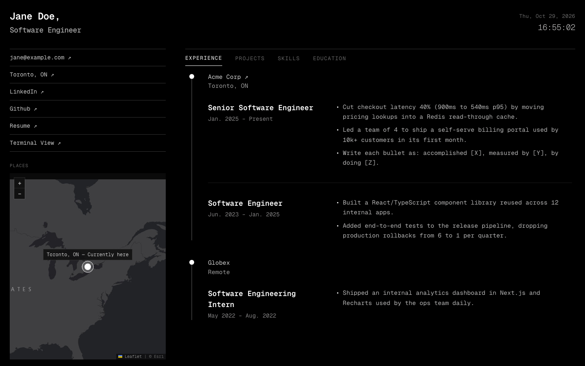

<div align="center">

# Portfolio Template

**A clean, minimal developer portfolio you can make your own by editing one file.**

[](https://nextjs.org)
[](https://react.dev)
[](https://tailwindcss.com)
[](LICENSE)

[**Live demo**](https://www.temp-portfolio.site) · [Get started](#-get-started) · [Customize](#-make-it-yours)

<br />



</div>

<br />

## ✨ Features

- **One config file.** Your bio, experience, projects, skills, education, and map pins all live in [`app/config/portfolio.ts`](app/config/portfolio.ts). No component hunting.
- **Two ways to browse.** A split-pane page with section tabs and a live clock, plus an interactive [`/terminal`](https://www.temp-portfolio.site/terminal) view that renders the same content as a command line.
- **Travel map.** A dark Leaflet map of the places you've lived and visited, centered on where you are now.
- **Zero setup.** No database, no API keys, no environment variables. Fully static, so it's fast and free to host.

## 🚀 Get started

Pick whichever is easiest.

### Option 1: Deploy in one click

[](https://vercel.com/new/clone?repository-url=https%3A%2F%2Fgithub.com%2Fthameem-a%2Fportfolio-template&project-name=portfolio&repository-name=portfolio)

Vercel copies this repo into your GitHub account and deploys it. Then clone your new repo and continue with [Make it yours](#-make-it-yours).

### Option 2: Use this template

Click **Use this template** at the top of this page, then:

```bash
git clone https://github.com/<you>/<your-repo>.git
cd <your-repo>
corepack enable   # installs the pnpm version this repo uses
pnpm install
pnpm dev
```

Open [localhost:3000](http://localhost:3000) and you're running.

> [!NOTE]
> Requires **Node.js 20.9 or newer**.

## 🎨 Make it yours

### 1. Edit your content

Everything on the site comes from [`app/config/portfolio.ts`](app/config/portfolio.ts). Replace the placeholder values in each section:

| Section           | What it controls                                                      |
| ----------------- | --------------------------------------------------------------------- |
| `personal`        | Name, title, email, location, links, and the page description          |
| `experience`      | Companies, with one or more roles and bullet points per role           |
| `projects`        | Name, link, year, tech stack, optional status (e.g. `"In Progress"`)    |
| `skillCategories` | Grouped skill lists                                                    |
| `certifications`  | Name, issuer, and link                                                 |
| `education`       | School, degree, dates, and optional coursework                         |
| `mapLocations`    | Pins on the travel map                                                 |

A few fields worth knowing about:

| Field                    | What it does                                                                       |
| ------------------------ | ---------------------------------------------------------------------------------- |
| `personal.handle`        | Username in the terminal prompt, e.g. `jane` → `jane@portfolio:~$`                  |
| `personal.description`   | Text shown in search results and link previews                                      |
| `personal.templateUrl`   | Adds a "Create your own" link under your contact links. Leave `""` to hide it       |

### 2. Add your map pins

```ts
{ name: "Toronto, ON", coords: [43.6532, -79.3832], type: "current", note: "Currently here" }
```

- **`coords`** are `[latitude, longitude]`. Right-click any spot in Google Maps to copy them.
- **`type`** sets how the pin looks:
  - `"current"`: highlighted, and the map opens centered on it. Use it for one pin.
  - `"lived"`: filled dot.
  - `"visited"`: hollow dot.

### 3. Swap the files

- **Resume:** replace `public/resume.pdf` with your own.
- **Icon:** replace `app/favicon.ico` with your own.

### 4. Ship it

Push to `main`. If you deployed with Vercel, it redeploys automatically.

## 💻 Terminal view

Visit `/terminal` for a command-line version of your portfolio. Type `help` to see these commands:

| Command                     | Shows                         |
| --------------------------- | ----------------------------- |
| `whoami`                    | Personal info                 |
| `experience`                | Work history                  |
| `projects`                  | Projects                      |
| `skills`                    | Tech stack and certifications |
| `education`                 | Academic background           |
| `contact`                   | Links and contact info        |
| `lightmode` / `darkmode`    | Switch theme                  |
| `clear`                     | Clear the screen              |

There are a few hidden commands too. Try `sudo`.

## 📁 Project structure

```
app/
├── config/portfolio.ts      ← all your content lives here
├── page.tsx                 main split-pane page
├── terminal/page.tsx        interactive terminal view
├── components/TravelMap.tsx travel map
├── layout.tsx               fonts and page metadata
└── globals.css              global styles
public/
└── resume.pdf               ← replace with yours
```

## 🛠 Scripts

| Command      | What it does                     |
| ------------ | -------------------------------- |
| `pnpm dev`   | Start the dev server             |
| `pnpm build` | Build for production             |
| `pnpm start` | Serve the production build       |
| `pnpm lint`  | Run ESLint                       |

## 🧱 Built with

[Next.js 16](https://nextjs.org) (App Router) · [React 19](https://react.dev) · TypeScript · [Tailwind CSS 4](https://tailwindcss.com) · [React Leaflet](https://react-leaflet.js.org) · Geist Mono · Map tiles by Esri

## 🙏 Credits

Design inspired by [Clean Personal Resume](https://www.figma.com/community/file/1495248085295405720/clean-personal-resume) on Figma Community.

## 📄 License

[MIT](LICENSE). Use it, change it, ship it. A link back is appreciated but not required.
